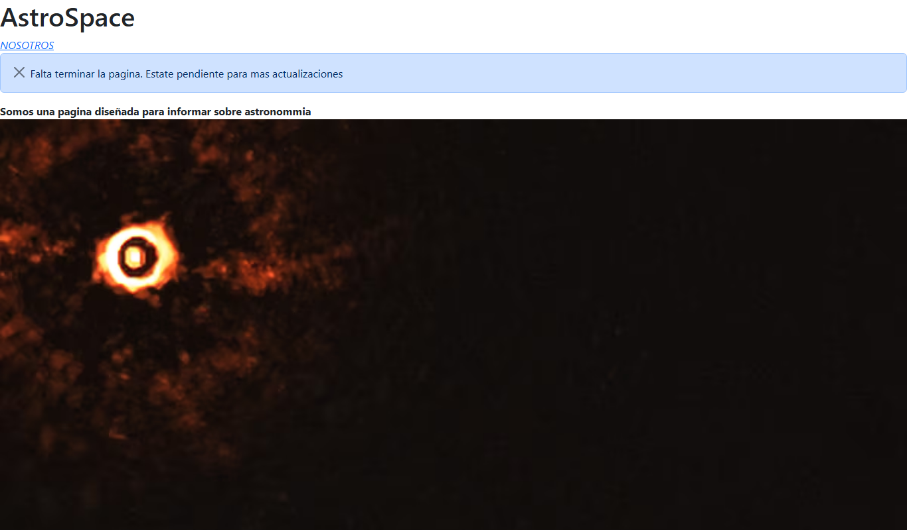

# AstroSpace: práctica de Bootstrap

Página informativa sobre astronomía para practicar los componentes de Bootstrap.

## Tecnologías

- HTML5
- Bootstrap 5.3 (desde CDN)

## Componentes usados

- Carrusel de imágenes con controles
- Acordeón con tres secciones
- Alerta que se puede cerrar

La página quedó en avance: el aviso de arriba indica que faltan secciones por terminar.

## Cómo verla

Abre `Bootstrap Proyecto/Index.html` en el navegador.

## Captura

## Autor

Juan Carlos González Herrera · [LinkedIn](https://www.linkedin.com/in/juan-carlos-desarrollador-web) · [Portafolio](https://moremaster123.github.io)
